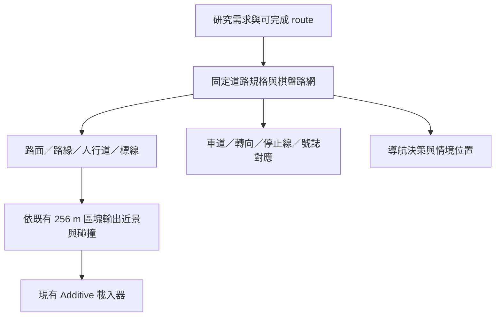

## 概述

目標為台北風格的虛構城市，提供可完成的騎行 route 與可控交通情境；不要求重建指定真實街區。

2026-11-08 調整方向：第一版先完成固定規格的平面棋盤街區與完整路面。以 [Taipei Rush](https://www.taipei-rush.app/) 的街面呈現為視覺參考，先建立道路、路口、標線與車流的共同規則。

本文件取代先前「先評估自由形道路工具與 Blender，再逐步拼接」的製作提案。2026-11-09 已完成可試騎的棋盤城市基礎版：共用道路資料、路面與標線、受控車流／行人及簡化街景；正式研究情境腳本與地圖編輯介面仍待接續。既有方塊串流版保留。

2026-11-25 素材比較後，後續美術採 **Kobo 風格的簡化城市**：共同色盤、乾淨色塊、以幾何表現主要結構，維持可信尺度與交通辨識。這是整體製作方向，包含自製／改製車輛、人物、道路及建築變體；建築仍需在地化與調整。首批以現有／免費素材製作樣板，再確認可擴充的品質；詳見下方「Kobo 風格與素材製作流程」。

2026-11-26 調整方向：**正式實驗路線先考慮有幹道、錯位路口與住宅支線的虛構街區**。Grid City 繼續提供路面、交通與串流的效能和功能測試。實驗地圖以能比較三種騎行任務為驗收依據，見下方「不規則街區與實驗路線」。

## 設計
### 硬體/軟體架構

#### VR head mounted display
* 主要開發於 HTC Vive Focus 3
* 現場有Quest3可以借
#### 測試
* 由Vive Business Stream + Steam VR 串流測試
* 2026-11-07 城市版建議 PCVR 串流優先；獨立頭盔版本保留為後續選項，先比較實際效能與部署需求，不列為同步交付條件。

### 玩家/受試者 

#### Motion Sickness
提供一些選項供調整:

#### 虛擬後照鏡/導航

### 城市街區設計 / 交通
* 已有約 1 km 級棋盤街區及約 2 km 環線。實驗原型先做單一不規則街區，依試騎結果再增加路線與街區。
* 方塊首版：`AIT > Riding > Open Streaming Blockout`；256 m、16 區、約 2.2 km 環線，使用原生 SceneManager Additive，常駐玩家／XR／選單／紀錄；近景與碰撞非同步載入／卸載，未就緒會擋住開始或暫停移動。尚未加入 lane graph、跨塊交通、Addressables 或可騎坡道。
* 素材按 route／情境缺口逐張需求尋找與驗收；先讓既有模型能在共同路面規格中使用，再補街景缺口。
* 沿用固定棋盤版建立的路面、標線與車流共用資料原則。先在 Unity 驗證不規則路口和完整路線，再依實際反覆修改的操作決定編輯工具。
* 目標為接近台北日常城市騎行的空間與交通情境，包含建築、汽機車、行人、斑馬線與紅綠燈；密度不必等同實際台北。
* 已有獨立的車輛與簡單街道試騎：`AIT > Riding > Open Urban Vehicle Preview`，先檢視 Car #26、TDAL 停車機車、號誌配色及單車直線停等；台北建築立面與自然車流仍待製作。
* 已有直角街區：`AIT > Riding > Open City Corners`，九個實際十字路口、自由騎行、兩輛受控左右轉車流。這是個別功能原型，尚未使用下述統一道路契約。速度為遊戲內共用設定，不使用地圖分段速限。
* 已加入 Unity 樣本手模型的靜態握把姿勢，隨把手轉向；不使用手勢追蹤或手指動畫。
* 棋盤城市基礎版：`AIT > Riding > Open Grid City`，約 1 km × 1 km、64 個路口、16 個載入區塊、約 2 km 環線。下述道路規格共用於路面、車道、停止位置與交通路徑，並有 6 輛受控 Car #26、12 名動畫背景行人、簡化街屋／騎樓與中文街牌店招。

#### 不規則街區與實驗路線

範例中的中正路是清楚的幹道。三民路形成另一條連續的動線，小巷則從不同角度進出兩條路。有的巷口只接一側，有的先穿過住宅街才接回，校地也使周圍街道改向。虛構街區採用這種道路層級。先定主要通行動線和一、兩塊會影響街道走向的校地或公園，再畫相連的住宅街，最後補巷口與街廓。直線路段保留給需要控制視距或車速的情境。

草圖使用約 **650 × 410 m** 的道路中心線範圍，預定路線約 **1.48 km**。幹道沿用 14 m 鋪面及雙向四車道，次要街採約 8–9 m 的雙向兩車道，住宅巷採約 6–7 m。這些是造景與試騎的初值，路緣、車輛掃掠與可視距離需在 Unity 確認。

| 情境 | 道路配置與第一輪測試 |
|---|---|
| 轉向導航 | 幹道上的兩個左轉口與進入住宅街後的兩個右轉口，皆有兩個相近且可通行的出口。提早轉入可經住宅街接回。評分以首次通過決策點時的出口判斷，接回路線後再繼續試次。 |
| 前方障礙 | 南側約 197 m 的雙向兩車道街段可放前方衝突。先用店角或停放車輛控制遮蔽和首次可見位置，進場車速和無障礙對照配對。記錄開始煞車、碰撞與適用時的最小 TTC。 |
| 換道／盲區 | 幹道東段約 186 m 的直線保留同向兩條連續車道，兩端留給匯入和減速。以慢車提供換道理由，控制鄰道車先占住盲區、再放出空隙，並量測過早跨線、正確等待及空隙出現後是否完成換道。 |

導航提示要讓騎士辨認是哪一個巷口。路名、動線和地標照常顯示，導航方向由該趟路線決定。先試兩個導航決策點，再擴充在近口、遠口和單一路口轉彎的路線，平衡左右方向、進場速度、路口辨識與練習順序。

場景、騎行路線和事件分開存。路線由有方向的街段序列構成，評分點記錄進入街段、允許的出口、預定出口和距離。沿線事件以街段／車道 ID、沿線距離和觸發條件綁定。用同一路線和事件配置比較有無 haptic，混合情境的活躍事件需錯開。重複試次要有不觸發事件的同類路段，並避免每次由固定地點和順序預告事件類型。錯轉時等接回並重新滿足下一事件的進場條件。

**Unity 原型順序**

1. 建一段實際可騎的幹道，含兩個相鄰 T 字巷口、接回街段及一個斜交路口。用有 ID 的中心線、寬度／車道規格、路口各入口的切線及合法轉向作為來源。先手排中心線和路口邊界，路面與車道等輸出由離線產生器生成。
2. 從同一份資料烘焙道路、碰撞／可行駛範圍、路緣、標線、停止線和 NPC 車道連接。現有 `CityRoadNetwork` 用固定間距找路口、用四方位選入口，`Route` 也用直線接路口。原型先實作任意街段的距離與道路範圍查詢，及按進／出車道 ID 的路口連接，供原本的騎乘、暫停和交通邏輯使用。
3. 在 Desktop 跑通預定與錯轉兩條路徑，檢查路緣旁的可行駛判定、停止線及 NPC 轉向，再延伸到換道和障礙段。平直處減少取樣，彎道依偏差加密，烘焙時計算三角形數量和碰撞連續性。首張街區先完整載入，之後由同一路網切渲染區塊，整個交叉口一起載入，路網和事件進度保持常駐。

上述 1.48 km 為完整路線草案，尺寸取自平面中心線。號誌配置、視距、路線分數分布與 VR 舒適度仍待驗證。

**可騎原型（2026-11-26）**。在 `AIT > Riding > Open Navigation District` 開啟，選 `Play Desktop`，從遊戲內選單開始。起點面向幹道東行。預定走第二個左轉口，進住宅街後走第二個右轉口，沿街繼續到末端右轉，繞回幹道後左轉往東。第一個左轉口可從下一個十字路口右轉再左轉接回。提早右轉則可在那條支路底端左轉接回。從暫停選單可重回起點。

道路有 16 段直線，靠錯位 T 字和斜交路口形成不等形的街廓。保留一段沿預留校地轉向的緩彎，以及東端 186 m 幹道。兩個左轉口相隔 51 m，兩個右轉口相隔約 55 m。每組有兩個合法、尺度接近的出口，分別通往實際可通行街段。路面與可行駛區域共用生成的平面多邊形。重新開圖後從共同起點騎通預定路線和兩條提早轉入的接回路線，並以射線驗證三條路徑下方皆有烘焙後的柏油網格。

幹道放入 Kobo 店屋，支線採 Kobo 住宅和公寓。生成時保留原始尺寸，由模型可見占地計算門面寬度和深度，將門面朝向道路並退至人行道或平路肩外。轉角或斜交街廓先驗證每棟占地與道路、路肩、人行道和其他建物不重疊，再放入場景。建物排列固定；研究版本要固定路口的遮蔽和地標，修改後重新核對視距。正式提示／評分、號誌／車流、南端障礙路段與 VR 實機驗收待接續。

住宅巷弄採平路肩，幹道與校地旁聯絡道保留抬高人行道。街段資料的 `raisedSidewalk` 決定是否生成抬高路面，巷口轉接會降低路緣高度。此場景道路邊緣會擋住出界而維持騎行，斜碰可以沿邊移動，正面碰到可以直接倒退。

改圖入口為 [NavigationDistrictLayout.json](../Tools/UnityValidation/NavigationDistrictLayout.json)。先放路口和出口，再調整街段斷面及驗證路線，最後重新排建築。執行 `python -B Tools/build_navigation_district.py --write-back` 會沿用本機 Kobo 騎乘組件和 prefab，在獨立 Unity 複本烘焙及試騎後寫回。本機場景放在 `BuildingComparisonLocal/NavigationDistrict/`，產生器和合成手把驗證留在 `Tools/`。畫面和驗證紀錄在 `Personal/NavigationDistrict/`。

##### 導航比較設計

以騎行表現來讀「手機導航 ≳ haptic ≫ 只看一次地圖」，主要指標為每個指定決策點的首次錯轉／漏轉比例。這是待驗證的假設。Kiss 等人的另一套觸覺腰帶在道路研究中觀察到比其手機視覺基線更少的轉彎錯誤，因此實驗也要能容許相反的排序。HaptiMoto 的近遠路口試驗實際出現了方向選對、卻轉進較近路口的錯誤。 [Kiss et al. (2018)](https://doi.org/10.1145/3173574.3174191) · [Prasad et al. (2014)](https://www.researchgate.net/publication/266655818_HaptiMoto_Turn-by-turn_haptic_route_guidance_interface_for_motorcyclists)

三種方式先在獨立的導航區塊比較。每趟在起跑前都用相同時間預覽該趟路線，之後分成手機視覺逐彎導航、把手觸覺逐彎導航、僅靠起跑前記憶。手機放在合理的把手位置，保留路線、箭頭和距離，關閉語音。觸覺用左右把手標示方向，先給準備提示，通過容易提早轉入的巷口後再確認指定出口。兩種即時導航讀取同一組目標路口與路線進度，依進場速度設定提示時間。先導測試要確認還有時間觀察與減速，避免為了做出差異而故意縮短提示時間或藏起路口。

使用難度相近的不同路線，交錯「轉第一口」「轉第二口」和一般路口，讓每種條件與路線順序在受試者間平衡。用出口閘線記錄首次選擇，分開記早轉、錯側、漏轉和後續接回。先訂定錯轉後下游決策點的計分規則，避免只統計成功抵達下游的人。另記離開前方道路的注視時間／次數，並量測基本騎乘控制。只有頭部追蹤時以低頭時間和幅度作代理，眼動可得時再計算離路注視。結論限於模擬器中的導航及視覺需求。

先導試騎用來估計錯誤率與路線差異，檢查三組是否都接近全對或全錯，並據此安排主實驗的決策數和受試者數。主實驗前先定義可接受的額外錯誤率差值，按受試者和路線的重複量測估計觸覺減手機的差值與區間。若目標為可替代性，檢查上限是否低於預設的非劣界值。若要聲稱兩者接近，檢查整段區間是否落在預設的等效範圍。另比較兩種即時提示各自對一次性地圖的改善。 [Lakens 的等效檢定方法](https://doi.org/10.1177/1948550617697177)

#### 固定棋盤道路第一版

本節的固定規格已實作於 `GridCity` 基礎版。完成範圍是可騎路面、共同資料、受控交通與基本街景；PCVR 效能、第三方舒適度與正式實驗效度仍需實際量測／試騎。

##### 先從實驗需求決定道路

| 最小需求 | 第一版必備條件 |
|---|---|
| 導航與左右轉 | 有方向選擇的路口、可辨認的街段／地標、連續可完成的 route，錯轉後能返回 |
| 前方障礙／前車 | 連續直線、明確車道、足夠的事件預備與結束距離，可重設相同初始條件 |
| 換道 | 至少同方向兩車道，標線與交通路徑一致；不能只做一去一回各一車道後才補救 |
| 受控交通 | 明確的停止線、號誌對應與左右轉連接，車輛沿合法連接運行，重載外觀不重設交通狀態 |
| 比較實驗 | 同一 world／route／scenario 版本可切換實驗條件，不因條件不同偷偷改道路、遮擋或事件位置 |

這些需求先由一種固定道路斷面承擔；首版不依賴窄巷、斜交、坡道或不等寬道路。

##### 共同尺度與拼接契約

以下是**本專案第一版採用的設計值**，不是 Taipei Rush 的量測值或法規尺寸；同一份資料產生各街段與路口，不讓各街段自行縮放。

| 項目 | 目前採用 |
|---|---|
| 基本交通方向／車道 | 右側通行、雙向四車道，同向各兩車道 |
| 單一車道寬 | 3.25 m，兩側各保留 0.5 m 路緣帶；鋪面共 14 m |
| 人行道 | 兩側各 3 m，道路走廊共 20 m；路緣高度全圖一致 |
| 相鄰路口中心距 | 128 m；街廓可建築區約 108 m 寬，建物／騎樓在這個範圍內佈置 |
| 完整路口保留區 | 48 × 48 m；停止線、穿越線與轉向連接包含在路口定義中 |
| 路口之間的標準直線 | 80 m，接在兩個路口保留區之間；以 8 m 單位對齊輸出，可在 chunk 分界完整拆分 |
| 與串流區塊的關係 | 保留 256 m 載入格。路口中心在世界網格原點起算的 `64 + 128 × n` m，兩軸相同 |

上述位置讓路口中心距 256 m 分界至少 64 m，48 m 完整路口可以留在單一 owner chunk；跨塊的是規格一致的直線。首版不讓網格任意切斷路口。地圖邊界使用有限種類的 T 字、彎角與端點，避免未定義的斷路。

每個道路模組只允許既定位置與 90° 旋轉、保持單位縮放；接點必須一致：位置／高度、道路與人行道邊界、車道數與順序、行進方向及路緣高度。接口不相容時要能明確指出錯誤，不能用重疊路面掩蓋。

##### 唯一來源與輸出順序

同一份路網與尺寸決定路面、標線、交通連接與 route；路口停止線的位置不可在繪圖與車流程式中各存一個不相干數值。道路／路口／車道採穩定 ID，模型名稱與場景物件身分不作永久研究識別。

先把直線、十字、T 字、固定 90° 彎角、端點做成有限集合。這些模組共用斷面與接點，特殊彎路不影響它們能否組成完整地圖。路網骨架確認後，使用者可以逐街廓放建築、招牌、停車與其他物件；未來地圖工具也是操作這套既有規格。

##### 路面樣板要一次包含的內容

第一個交付是**完整十字路口＋四側標準直線與街角**，要能從機車座位與後照鏡判讀：

- 具比例的瀝青路面、中央分隔／車道線、道路邊界與可見路緣。
- 停止線、斑馬線、方向箭頭、號誌，以及依該路口配置的機車停等區／待轉區；標線配置先選定一套，再全圖一致使用。
- 可連續行走／佈置的街角人行道與建築基底，足以提供騎乘速度與轉向的視覺參照。
- 共用資料產生的車道中心、左／直／右轉連接與停止位置，受控車輛可以實際通過。

已用獨立背景瀏覽器查看 Taipei Rush 的訪客街面與大地圖：規則路網搭配可辨認的車道線／穿越線、路緣、人行道、號誌及連續街邊建物，能在簡化地圖中形成城市感。這是本版要參考的整體基礎；未從畫面推定實際公尺尺寸或程式架構。

Taipei Rush 是街面層次與城市辨識感的參考，不照搬其模型、程式或第三人稱尺度，也不以瀏覽器表現推定 PCVR 效能。首版美術可簡化，路面尺度、轉向空間與交通連接必須成立。

幾何成本從固定模組控制：平面道路少量面、標線用適當的薄片／材質、共用材質與模型、簡化碰撞；逐模組列出三角形、材質與碰撞成本，再依可見數量與鏡面實測。依空間範圍合併，不合成整座城市；不依賴最後對全城做任意減面來修復輸出。

##### 交付順序與結束條件

| 階段 | 實際可看的交付 | 下一步條件 |
|---|---|---|
| 1. 道路樣板 | 一個完整路口、四側直線與街角，含標線與低流量受控車流 | 座位／鏡面能辨認；左右轉、直行、停等與同向換道空間成立，固定共同尺寸 |
| 2. 固定街區 | 同一套模組組成 3 × 3 路口、含跨 chunk 直線與可返回路線 | 所有接口連續、路口無半邊卸載、車流與停止線對齊；不依賴逐處修模型 |
| 3. 實驗城市 | 約 1 km 級棋盤、約 2 km route，沿線有建物／路緣／號誌與可控交通 | 導航、前方障礙、換道能各自重複執行，跨區載入與返回不改變任務狀態 |
| 4. 地圖編輯 | 選區域、放置／旋轉允許的道路模組、佈置街廓與事件並儲存 | 使用者可自行做出另一條完整路線，輸出仍遵守相同契約 |

首版完成即以階段 3 的可實驗城市為目標；階段 4 改善內容製作效率。曲線、變寬、不同斷面、斜交、高低差均不列為此目標的前置。後續若有明確研究需求，再新增相容變體／轉接模組，保留已驗收固定版可使用。

##### 2026-11-09 實作與試騎

**開啟：`AIT > Riding > Open Grid City`。** 沿用 `Setup and Play Mode` 選 Desktop／VR，Play 後等附近區塊準備完，放開油門／倒退鍵再從遊戲內選單開始。VR 以控制器射線／扳機操作，左 X 暫停；共用速度、坐姿校正、設定檔、靜態雙手與後照鏡均沿用原流程。

**Desktop 視角（2026-11-23）**：選 `Play Desktop`，開始／繼續騎行後滑鼠會鎖定並隱藏，移動滑鼠即可模擬轉頭；左右可轉看身後，上下限於 ±80°，不改變車輛轉向或坐姿位置。`C` 回到設定檔的初始觀看方向；`Esc`／`P` 暫停並釋放游標，`F2` 開啟選單後也可用滑鼠操作。切離 Game view／應用程式時暫停並釋放游標，回來後須再次開始／繼續；暫停前的轉頭角度會保留。鍵盤 `W` 油門、`A/D` 轉向；`S` 於前進時煞車，持續按住至停妥後低速倒退，倒退時放開即停，`R` 亦保留為倒退鍵（2026-11-25）。同按 `W+S` 以煞車優先；開始前須放開 `W/S/R`。倒退沿用設定檔上限，預設 3 km/h；手把與 VR 的煞車仍只負責煞停，倒退鍵不變。也可搭配手把騎行與滑鼠轉頭。滑鼠視角為暫時狀態，不寫入設定檔；校正或載入設定檔仍會回到該檔的初始觀看方向。VR 頭部追蹤與控制器選單不變。

Desktop 增量驗證：`python Tools/check_desktop_look.py` 在忽略的獨立專案跑實際 Play loop，以合成滑鼠／鍵盤檢查轉頭不改車向、靜止不漂移、回正、俯仰限制、暫停／繼續、F2、焦點回呼與釋放游標狀態。無視窗環境以替身隔離原生 Cursor API，不操作 Windows 滑鼠；實際 Game view 的鎖定、切離視窗與靈敏度仍需手動試用。結果在 `Personal/RepairValidationProject/Personal/DesktopLook/`。

2026-11-25 鍵盤倒退驗證：`python Tools/check_keyboard_reverse.py` 在同一獨立複本的 Kobo 比較場景跑實際 Play loop，PASS。檢查 S 按住時禁止開始、W 前進後持續 S 煞停轉倒退、倒退上限、靜止 S 倒退／放開停止、倒退後 W 轉前進、W+S 煞車優先、R 相容；另以合成 Gamepad 檢查左扳機仍只煞停。只使用合成裝置，未操作 Windows 輸入或實體控制器；結果在 `Personal/RepairValidationProject/Personal/KeyboardReverse/`。

本版依「路面 → 行人／車流 → 城市街景」完成：

| 部分 | 實際內容 |
|---|---|
| 路面 | 14 m 雙向四車道、中央雙黃線、同向虛線、路邊界線、方向箭頭、停止線、斑馬線、寫有「機車」的停等區、15 cm 路緣與 3 m 人行道 |
| 路網 | 64 路口／112 街段／448 有向車道／784 允許的車道轉向；路口完整歸一個 chunk，跨區直線銜接；邊界為 T 字／固定彎角 |
| 交通 | 6 輛沿既有固定 LOD0 Car #26，分成受控左／右轉閉合路線，預設巡航 20 km/h；後軸停止距離由畫出的停止線計算 |
| 行人 | 3 種 Quaternius CC0 簡化模型，共 12 人在 6 個路口等待／步行穿越；idle／walk 動畫、約 1.72 m 身高；穿越時車輛保持全紅，清空後再放行 |
| 街景 | 392 棟簡化中層街屋、退縮店面／騎樓柱列、224 棵低面數路樹、中文街牌與店招；外觀作尺度／速度／遮擋參照，建物不可進入 |
| 串流 | 延用 16 個 256 m Additive 區塊；玩家／XR／UI／路口時鐘／交通 actor 常駐，附近街面與訊號燈外觀分塊；遠方保留簡化輪廓 |

交通是可重複的低流量示範，尚非自然人群、完整台北交通規則或經驗證的行為模型。行人採專用全紅穿越保留，基礎號誌週期因此可延長。騎士仍自行看號誌與煞車，沒有紅燈強制停止；車流會在紅燈停止線前停等。暫停選單時交通與行人一起暫停。尚未加入兩段式待轉的完整標線／操作規則。

場景為自由騎乘。約 2 km 的參考環線為：起點建國路北行 → 中興街右轉 → 中正路右轉 → 青田街右轉 → 建國路右轉返回。沿途還會遇到東華街、新安街與明德街，這些路口先直行。街名是虛構配置；不代表現實台北相對位置。路線有有序檢查點與完成事件，沒有導航提示或錯轉重新規劃。暫停後可選「回到路線起點」。

接近直角路口先降至約 10–15 km/h；全域速度上限仍可由遊戲內「速度」調整，沒有地圖強制速限。碰到路緣會保留最後可騎位置並暫停；重新開始後可低速倒退移車。碰撞採簡化停止保護，不是車輛／行人撞擊動力學。

**資料與素材**：`Assets/MotorSimulatorAssets/GridCityGenerated/RoadNetwork.asset` 是共用路網，`CityWorld.asset` 是串流目錄；`Modules/` 提供直線／十字／T 字／彎角／端點外觀 Prefab。它們是離線產生的輸出，直接改 mesh、縮放 Prefab 或改輸出參數不會同步重建全城；正式地圖編輯工具尚未完成。端點 Prefab 尚無自動車流迴轉連接，當前完整路網未使用它。

街屋、路面、路樹與標線為專案產生的簡化幾何／材質。行人來源、原始授權、修改與原檔雜湊在 `Models/QuaterniusPedestrians/`；中文標示由 `Tools/create_city_signage.py` 使用 Noto Sans TC 產生，字體為 SIL OFL 1.1，來源與授權在 `Models/CitySignage/`，原字體檔只留於 `Personal`。未使用 Taipei Rush 的模型或程式。

**軟體驗證**：在忽略的專案複本建置 Windows Player，用實際 input／Update／FixedUpdate 騎完約 2 km，檢查道路邊界、舊 500 m 邊界、跨區載入／卸載、倒退、常駐 XR／路口身分、車輛紅燈停止與左右轉、動畫行人穿越期間全紅。另以 GPU 離線擷取騎乘、後照鏡、路口與人物畫面檢視材質。驗證程式只在 `Tools/`，結果在 `Personal/RepairValidationProject/Personal/GridCity/`，不匯入主專案。

本次結果：PASS，實際騎行 1,994.9 m、最高 30 km/h；載入 24 次、卸載 15 次、最多同時就緒 12／16 區；受控交通測試完成 128 次行人穿越。路面／標線／人行道全城共 32,176 個三角形；含訊號燈與簡化街景的靜態輸出共 135,464 個，車輛／行人另計。這些是軟體／幾何檢查數字，非 PCVR 效能預算。寫回主專案後另確認場景與資產引用完整、沒有重複引用 GUID，主專案的 Runtime／shader 與驗證版本一致。

**尚待實機／研究接續**：Focus 3 PCVR 的雙眼標線清晰度、遠處閃爍、鏡面、冷／暖載入的 CPU／GPU 峰值與第三方舒適度；Quest 3 另行驗收。尚未加入正式導航／障礙／換道試次腳本、完整交通軌跡紀錄、可編輯地圖工作流、坡道或 Addressables。無繪圖 Player 驗證不代表 VR 幀率或真實性驗收。

開發驗證、產生器與離線輸出維持在 `Tools/`；主專案 Editor 只提供使用者實際使用的開圖、設定與製作操作。現有載入器與騎乘 UI 沿用；不因道路樣板製作重新設計設定檔或校正流程。

#### 街景素材比較：Pasha／Kobo（2026-11-25）

入口為 `AIT > Riding > Streetscape Comparison > Open Pasha`／`Open Kobo`，再選 `Play Desktop`。兩個場景沿用既有騎行選單、設定檔、滑鼠轉頭、倒退與速度調整；暫停選單可回到路線起點。比較時停止 Play 後開另一個場景。這是供使用者試騎／選素材的場景，產生器與驗證程式仍只在 `Tools/`。

兩版使用相同的九路口道路、日光、騎乘起點、兩輛受控 Car #26、兩名動畫行人與一輛停車遮擋物；中央道路兩側各佈置兩段約 100 m 店面。保留各套建築的尺寸、外形與貼圖風格，因此量體、實例數和遮擋仍不同；此比較不構成受控制的視覺擬真度實驗，也未加入正式事件生成系統。這兩個本機場景不會替換 Grid City。

| 素材 | 本次處理與觀察 |
|---|---|
| [Pasha — Tai wan buildings pack](https://sketchfab.com/3d-models/tai-wan-buildings-pack-e40921ac50604b97b4d8f48cf13a25b3) | 從使用者提供的 ZIP 再解開 `source/Mo_3ds.zip`，以 Blender 4.5.16 和 Autodesk 3DS 匯入器讀取；移除六張航空影像參考平面及零面空物件，保留所有其餘 5,691 個三角形、UV 和原貼圖。原檔不是 27 個獨立建築，而是八組主要連通幾何及分離細節；整理為八個 FBX／Prefab，逐組確認店面方向。以英吋推定原單位、轉為公尺，尚非作者認證的實際尺度。近看保留原貼圖模糊、烘焙陰影和品牌內容等限制，未做重繪。 |
| [Kobo — Low Poly Japanese Town Buildings](https://www.fab.com/listings/72f9e3a7-9519-4494-86db-359b56635b52) | 使用 FBX v1.2.2 的 57 個模型（含色彩變體）與色盤，保留公尺尺度。建立 URP 材質，隱藏 UCX 及假陰影網格，給建築簡化碰撞；未匯入廠商的 Editor 程式或 LOD 跳換。窗框、陽台等幾何層次較清楚，外觀與量體偏日本商住建築；來源標示 AI-assisted。 |

目前比較場景的建築輸出：Pasha 放置 20 組，14,856 個可見三角形、29 個共用材質；Kobo 放置 36 棟，207,672 個可見三角形、3 個共用材質。車、人、道路另計，數字不是總可見成本或 VR 效能驗收，也不能單憑面數判斷哪套較快。

素材與場景位於 `Assets/MotorSimulatorAssets/BuildingComparisonLocal/`，連同 `.meta` 隨私有研究專案同步。`Prefabs/Pasha/`、`Prefabs/Kobo/` 可供自行佈置，`Scenes/` 為比較場景。來源、原檔 SHA256 和轉換版本在該資料夾的 `source.json`，Kobo 的授權摘要隨附於 `Kobo/README.md`。原始壓縮檔留在 `tempSpace/`，解壓與中間成果位於 `Personal/BuildingComparison/`，不納入 git。

重建：`python Tools/build_streetscape_comparison.py --check --write-back`。需保留下載的兩個 ZIP，以及目前指定的 Blender portable；3DS 匯入器只載入離線程序，不修改使用者的 Blender 設定。腳本會重建上述本機產物；欲手動編修比較場景，請先另存為自己的場景。

驗證：獨立 Unity 複本完成兩版實際 Play loop，各以鍵盤輸入騎行超過 100 m，確認共用道路引用、開始／暫停、倒退與放開停止、兩條車流路徑可運行；另檢查材質、模型尺寸與缺失腳本，以 GPU 擷取含機車／雙手／後照鏡的騎乘視角、側看、路口與鳥瞰。結果與畫面在 `Personal/RepairValidationProject/Personal/BuildingComparison/`。尚未量測實機 VR 幀率，也未驗證這些素材的研究效度。

#### Kobo 風格與素材製作流程（2026-11-25，製作規劃）

使用者試騎後偏好 Kobo 的整體外觀，認為建築照片貼圖的細節與違和感不利於目前目標。後續採其**風格方向**，持續調整既有建築並製作變體。「騎士通常不注意建築細節」保留為設計假設；這次個人體驗不能推論不同風格的研究結果等效。

##### 共同視覺標準

| 項目 | 首版約定與檢視重點 |
|---|---|
| 比例與輪廓 | 依公尺尺度、可信的車寬／車長／人高製作，主要結構以簡潔幾何表現。車身、輪胎、人物四肢與建築開口保有可辨認輪廓；低面數不應造成近處車輪呈明顯多邊形。人物頭身比例先由樣板確認，再用於所有年齡變體。 |
| 色彩 | 以本機 Kobo `palette32.json` 的既有色盤為基準：奶油白、藍綠、赭黃、灰、深色等。新增車、人、店面也使用共同色盤；膚色可補充共同色票。交通號誌、煞車燈、方向燈及路面標線保留用途所需顏色與對比，獨立列入功能色。 |
| 表面與光照 | 乾淨色塊與受控明暗、柔和日光陰影；先避免照片立面、烘焙環境陰影、密集髒污和高反射車漆。主體採共用 URP 材質設定；車窗、燈光與少量必要透明件分開處理。 |
| 細節層次 | 建築保留店面、窗框、陽台、騎樓／雨棚等結構；車輛保留車窗、車燈、輪胎、後照鏡；人物保留衣著與姿態差異。自車座艙、雙手、近距離前車需比遠方背景仔細。各類別的細節密度須並排確認。 |
| 道路與資訊 | 保留既有路網尺度、可讀標線、號誌與中文指引，瀝青使用低對比的簡化表面。先守住騎乘視角、接近路口與後照鏡的辨識，再增加裝飾。 |
| 變體 | 建築以樓層／開間、店面、屋頂、陽台、招牌、騎樓組合改變輪廓；車輛改變車身類型與尺寸；人物改變年齡、體形、服裝與步態。單純換色只算配色變體。 |

這是樣板製作的共同標準，還沒有宣稱現有所有模型均已符合。現用 Innerscene／TDAL 機車、Car #26 與 Quaternius 行人須各自評估改製成本。共用材質只解決一致性的一部分；比例、幾何細節、動作與光照也須在同一畫面驗收。

##### 首批範圍與驗收順序

使用者選擇先用現有／免費素材，車、人各約 2–3 類，能完成實驗優先。首批安排如下；**此表是待製作內容，不是已完成模型清單**。

| 類別 | 首批樣板 | 必要功能／後續擴充 |
|---|---|---|
| 機車 | 自車與 NPC 共用從 TDAL `scooter_d.FBX` 改製的通勤速克達。外觀採整合式車燈、平踏板、包覆側殼與長座墊。 | 車頭與前叉隨把手轉動，車殼固定，前後輪分別滾動。自車有儀表、可用後照鏡與握把雙手，NPC 有簡化騎士。 |
| 汽車 | Quaternius LowPoly Cars 的 `NormalCar1` 轎車與 `SUV`，兩者採同套低面數底模。 | 已在 Blender 匯入確認分別為 2,954 與 3,294 個三角形，各有獨立的左右前輪及共用後輪網格。改製要檢查近景輪胎圓度、車身比例及燈具，並讓煞車燈與方向燈能獨立控制。 |
| 行人 | Kobo 預覽已換成 1.62 m 與 1.74 m 的便服成人，使用具有自然腿長和頭身比例的骨架。 | 兩側人行道可實際步行，路口以全紅保留供行人穿越。後續老人可改成人的體態和步幅；兒童另做頭身及四肢比例。 |
| 建築與道路 | 現有 Kobo 參考建築、一個含店面／騎樓的在地化建築變體、一段既有路口與街面 | 保留共用路網資料；建築變體以可重用構件製作，之後再擴成街廓。 |

公車、卡車、貨車、腳踏車與更多人群按情境缺口擴充。新增腳踏車需同時處理騎士姿勢／踏板動畫與行進路徑；大型車需處理車體掃掠與轉彎軌跡，納入時另行驗收。

NPC 騎士先用已入庫、可擺姿的 Quaternius `Casual2_Male`。第一版做一個坐姿，雙手落在握把、雙腳落在腳踏板，配簡化的安全帽、外套和長褲，用整體輪廓與服裝色塊呈現。騎士隨車身轉向與傾斜，近距離驗收手腳接觸與穿插。玩家第一人稱沿用握把上的雙手。停等時單腳落地可在需要展示該動作的情境再補。

來源見 [Innerscene Urban motor scooter](https://www.innerscene.com/tools/library/3d-parts/urban-motor-scooter-9dd945f9)、[Quaternius Cars Bundle](https://poly.pizza/bundle/Cars-Bundle-FE5IWe6OMk) 與 [Ultimate Animated Character Pack](https://quaternius.com/packs/ultimatedanimatedcharacter)。汽車候選 GLB 與底模預覽保留於 `Personal/KoboAssetSelection/`。

先完成**一台速克達及其 NPC 騎士樣板**，並在既有 Kobo 街面檢視騎乘座艙，以及從後方與側方看 NPC 的整體輪廓。依樣板確定的比例、色盤及細節密度接續汽車、行人與建築變體。

**Unity 交通街景樣板（2026-11-25）**。開啟 `AIT > Riding > Streetscape Comparison > Open Kobo Traffic Preview`，選 `Play Desktop`，從遊戲內選單開始。起點前方約 14 m 有一台赭黃色速克達與戴安全帽的騎士。白色休旅車在左側同向車道，藍灰轎車在前方。右側人行道有成人樣板，前方路口有兩名沿用既有步行動畫的成人。

樣板以同一條 Kobo 街景看車、人和道路的比例與色彩。汽車微調車頂高度、替換霧面色盤、重做圓形胎面並接上輪軸與煞車燈。NPC 騎士採固定坐姿並隨車傾斜，轉到較大角度時手與握把會有位移。現有成人行人可作街面比例參考，兒童、老人和新建築變體留在後續批次。

**通勤車型更新（2026-11-26）**。Kobo Traffic Preview 的自車與 NPC 已換成使用者提供的 TDAL Scooter D，沿用 Kobo 配色，依網格的連通部件把車殼、把手和前叉、前後輪拆開。自車改用車型對應的儀表、握把位置與鏡面，NPC 騎士重新貼合踏板與座墊。模型長 1.90 m、含鏡寬 0.77 m、軸距 1.35 m，簡化機械細節後有 48,317 個三角形。這些是素材尺寸。先前的復古速克達仍可在原 Kobo 比較場景看到。TDAL 變體保留在本機素材目錄。 [台灣山葉勁豪 125 外形與規格](https://www.yamaha-motor.com.tw/news/news-202508-axis-z) · [TDAL 授權協議](https://www.tdal.tw/tw/webcontent/license_agreement)

場景及改製素材位於 `Assets/MotorSimulatorAssets/BuildingComparisonLocal/TrafficPreview/`，素材來源見同資料夾的 `Sources.md`。原 Kobo 比較場景可作對照。可用 `python -B Tools/build_kobo_traffic_preview.py --write-back` 從已取得的底模重建樣板，產生器只在 `Tools/`。Unity 截圖及 Play 驗證報告在 `Personal/KoboTraffic/`，驗證包括從選單開始、實際騎行 100 m、倒退停止、三輛 NPC 車輛沿路線行進與車輪轉動。實機 VR 效能待另測。

比例與車殼修訂以實車軸距、座墊和騎姿為基準。勁豪 125 軸距 1.275 m、座高 0.755 m，PCX 姿勢圖的軸距 1.315 m、座高 0.764 m。樣板速克達軸距 1.33 m。將 NPC 騎士骨架縮約 9%，收窄肩肘與安全帽，重新配合座墊、握把和踏板，坐姿的帽頂距路面 1.74 m。參考來源為 [台灣山葉勁豪 125 規格](https://www.yamaha-motor.com.tw/news/news-202508-axis-z)、[山葉在台開發部門的雙載照片](https://www.ymrt.com.tw/en/news/news_01.aspx?AnnouceSeq=1)與 [Honda PCX 側視騎姿圖](https://www.honda.co.jp/factbook/motor/PCX/202012/P15.pdf)。

汽車在車殼增加一層曲面幾何並調整表面法線，在玻璃、燈具和車牌邊緣保留較多原輪廓。Unity 測得轎車外觀長／寬／高約 4.21／1.78／1.39 m，休旅車約 4.21／2.07／1.66 m，寬度含後照鏡。含車輪與燈具分別為 8,456 與 9,852 個三角形。同視角的舊截圖留在 `Personal/KoboTraffic/BeforeProportionAdjustment/`，新版另有汽車正面截圖。

2026-11-26 對車殼曲面局部放鬆網格，保留窗、燈和飾件交界，以降低細長面交界的皺褶。近看輪拱仍有可見折痕。通勤車更新前的同視角畫面保留於 `Personal/KoboTraffic/BeforeCommuterScooter/`。

**街道尺度校正（2026-11-26）**。在同一條街從路面量起，預覽場景的坐姿眼高為 1.38 m，Desktop 初始視線下俯 8°。轎車長／含鏡寬／高為 4.43／1.82／1.48 m，軸距 2.56 m。小型休旅車為 4.31／1.93／1.66 m，軸距 2.63 m。碰撞框和停等距離會跟著車身尺寸。NPC 重新配合座墊、握把和踏板，帽頂從 1.74 m 調為 1.64 m，仍高於轎車，約和休旅車頂同高。這是本場景的短身形騎姿樣板。乘坐校正仍可按實際受試者調整，手動載入設定檔時會套用該檔的眼高與視角。車型尺寸參考 [Toyota Vios](https://www.toyota.com.tw/showroom/VIOS/fullsepc.aspx) 與 [Toyota Yaris Cross](https://www.toyota.com.tw/showroom/YARISCROSS/fullsepc.aspx)。

街景校對使用 3.25 m 車道、14 m 鋪面、3 m 人行道、15 cm 路緣、1.72 m 成人行人，以及含基座 12.10 m 的三層 Kobo 店屋。這些尺度在 Unity 內與車輛共同檢查，可在 `Personal/KoboTraffic/scale-eye-level.png` 看等距並排的水平視角，在 `rider.png` 看實際預設座艙。道路斷面參考 [市區道路設計規範的尺寸表](https://gazette.nat.gov.tw/EG_FileManager/eguploadpub/eg030173/ch02/type2/gov10/num2/Eg.pdf)。

**成人行人樣板（2026-11-26）**。`Open Kobo Traffic Preview` 的行人換成 1.62 m 與 1.74 m 兩個便服成人樣板，按頭部骨架位置量測約 7.7 頭身。兩人在起點街廓兩側的人行道上走動，在路徑端點短暫停下、轉身後折返。另兩人於中央路口等候全紅保留，再走斑馬線。與車流一起暫停，回到路線起點會重設行人位置。行走速度為 1.16–1.27 m/s，播放速率用重新配骨後的步態位移估算。平面接地由取樣鞋底校正，路緣沿既有坡面高度行走。

人物以 CC0 的 Quaternius Universal Base Characters Standard 改成便服與鞋，另將 Universal Animation Library Standard 的 Idle／Walk 轉到各成人骨架並烘焙。重建需把官方免費 ZIP 留於 `Personal/PedestrianSource/base.zip` 與 `motion.zip`，執行 `python -B Tools/build_kobo_traffic_preview.py --write-back`。Unity 可看 `Personal/KoboTraffic/pedestrian-sidewalk.png` 與 `pedestrian-crossing.png`。Play 驗證重新開圖後四名行人的動畫引用仍有效，量測走路期間手與腳相對身體的位移，並確認人行道路徑和全紅穿越。 [成人底模來源](https://quaternius.itch.io/universal-base-characters) · [動畫來源](https://quaternius.itch.io/universal-animation-library)

每批共同驗收：固定同一座位高度、FOV、日光與曝光，並排保留原版／改製版；查看近距離座艙、2／10／30 m 前車、路口側看及後照鏡，包含靜止與移動。檢查色彩、比例、輪廓、細節量、遮擋、燈號、步態與距離跳換；由使用者確認這組樣板可作下一批基準。同步記錄三角形、材質、貼圖、可見實例與 CPU／GPU 成本，再決定幾何預算；後續 LOD 須保持輪胎／車身輪廓並重看騎乘過程的跳換，不能只看面數。

##### 工具與素材來源的分工

1. **既有／免費底模 → Blender 改製 → Unity 樣板**為預設流程。保留原檔與授權，另外整理可編修的 `.blend`、匯出 FBX、必要貼圖與 Prefab；調整尺度、輪廓、細節、UV／色盤與可動分件。新建簡單車體構件、道路物件、招牌與建築模組可由專案腳本製作；自然人體與動畫優先採成熟基底。
2. 在同一條參考街驗收美術與功能後，再製作配色／車型／服裝／樓層等變體，沿既有 chunk 與 Prefab 流程擺設。建築模組新增開口、騎樓或屋頂時也回到這個基準驗收。
3. 只有某一類底模無法有效改製時，才比較定向尋找、購買或 Tripo 單件試作的成本。生成物仍需整理拓撲、尺度、色盤、骨架／可動零件；生成成功次數不能代表可直接使用的素材數量。現階段不需要付費服務或 API key。
4. 每件素材保留來源、授權、修改項目、版本與功能掛點；需要排除原始／修改資產的授權沿用本機排除規則。Kobo 衍生內容繼續留在排除的本機目錄，產生器／驗證留 `Tools/`。後續重建不得蓋掉手工編輯的 `.blend` 或場景。

現有 Blender 4.5.16 portable、Python、Unity／URP 已足夠開始此流程；可先以背景腳本處理，不需接管使用者電腦或另裝美術工具。若之後需處理人體權重或複雜曲面，先以實際樣板暴露品質／工時限制，再決定是否引入專業製作。

##### 已查到的後備來源與車種資料

- [Kobo Town Cars](https://www.fab.com/listings/f9148caf-66bc-4d24-9dca-1af8e01ada53)：官方列出六種車身、共用 palette32、獨立車輪與燈具，提供 FBX；可列為未來替代底模。包含轎車、廂型／小貨車等，但不能據此認定已補齊休旅車或台灣車種。價格需取得實際商店報價；本輪不購買。
- [Kobo Town NPCs Vol.2](https://www.fab.com/listings/80729d76-78a5-4015-91e5-6291e3c79124)：有綁骨與步行等動畫，但作者明示 cute 風格；同作者不等於人物頭身比例自然適合本專案，需檢視再決定。
- [Quaternius Universal Base Characters](https://quaternius.com/packs/universalbasecharacters.html)：官方列出 CC0、不同體形與 Humanoid 骨架，免費／完整 Source 版內容有別。可評估作人物基底，現有行人也可先用於材質與步態樣板；不能直接認定已涵蓋兒童／老人需求。
- [Tripo API 官方費率](https://developers.tripo3d.ai/en/pricing)可按生成、處理、綁骨分別計費。將來若試作，先為一件失敗重試與後製一起估價，與改製既有模型的工時比較；API 與 Studio 訂閱分開看。目前採免費樣板，不啟用。
- [臺北市機動車輛登記數](https://data.taipei/dataset/detail?id=ce44d079-6588-4dad-9232-9ecb88f205ff)提供小客車、小貨車、大客車、大貨車與機車類別，可作交通組成的分類參考；該表不是特定街道流量，也沒有轎車／休旅品牌車型的完整拆分。首批車種按實驗所需遮擋與辨識差異選擇；將來需仿真出現比例時，再另找有時間／路段條件的交通量資料，保留來源與採樣限制。

### harzard 生成

規劃將 route 與 scenario 分開，保留導航、前方障礙與換道的單一任務，再到不重疊／可能重疊的混合任務。事件以車道／路口／沿線位置與前置條件識別，不依 chunk 載入時刻觸發；本輪尚未實作此情境系統。

### Metric、sersors與紀錄系統

## Related Works

