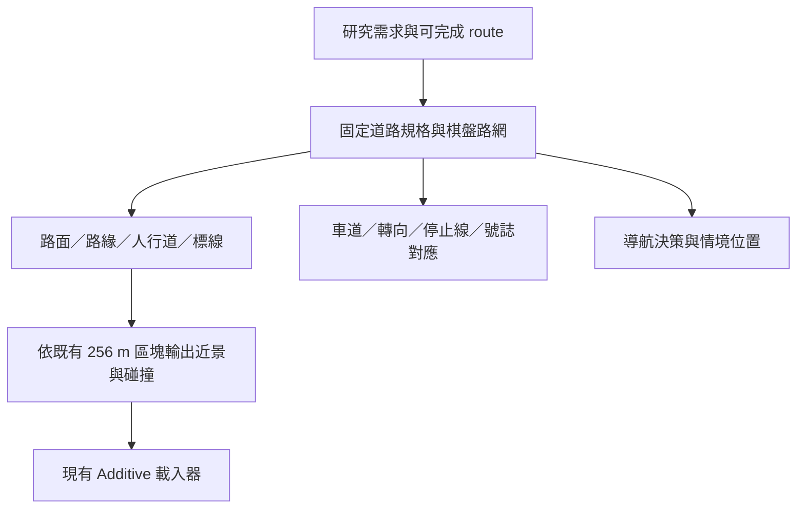

## 概述

目標為台北風格的虛構城市，提供可完成的騎行 route 與可控交通情境；不要求重建指定真實街區。

2026-11-08 調整方向：**第一版先完成固定規格的平面棋盤街區與完整路面，以此支援實驗。** 以 [Taipei Rush](https://www.taipei-rush.app/) 的街面呈現為視覺參考，先固定道路／路口／標線／車流的共同規則，再從同一套規格組成地圖。彎曲、變寬、斜交與坡道是後續選項；即使不實作，固定街區仍應能獨立完成導航、前方障礙與換道實驗。

本文件取代先前「先評估自由形道路工具與 Blender，再逐步拼接」的製作提案。2026-11-09 已完成可試騎的棋盤城市基礎版：共用道路資料、路面與標線、受控車流／行人及簡化街景；正式研究情境腳本與地圖編輯介面仍待接續。既有方塊串流版保留。

## 設計
### 硬體/軟體架構

#### VR head mounted display
* 主要開發於 HTC Vive Focus 3
* 現場有Quest3可以借
#### 測試
* 由Vive Business Stream + Steam VR 串流測試
* 2026-11-07 城市版建議 PCVR 串流優先；獨立頭盔版本保留為後續選項，先比較實際效能與部署需求，不列為同步交付條件。

### 玩家/受試者 

#### Motion Sickness
提供一些選項供調整:

#### 虛擬後照鏡/導航

### 城市街區設計 / 交通
* 第一版先使用約 1 km 級棋盤街區與一條約 2 km、可完成且可重複的 route。約 2 × 2 km／5–8 km 主線保留為後續擴充，不是固定街區版完成的前提。
* 方塊首版：`AIT > Riding > Open Streaming Blockout`；256 m、16 區、約 2.2 km 環線，使用原生 SceneManager Additive，常駐玩家／XR／選單／紀錄；近景與碰撞非同步載入／卸載，未就緒會擋住開始或暫停移動。尚未加入 lane graph、跨塊交通、Addressables 或可騎坡道。
* 素材按 route／情境缺口逐張需求尋找與驗收；先讓既有模型能在共同路面規格中使用，再補街景缺口。
* 製作流程改採本文件下述的「固定棋盤道路第一版」。先完成共同道路規格與實際路面樣板，確認整圖可組裝，再做使用者會操作的地圖編輯功能。EasyRoads3D、Blender 與自由形道路系統不作為交付前提。
* 目標為接近台北日常城市騎行的空間與交通情境，包含建築、汽機車、行人、斑馬線與紅綠燈；密度不必等同實際台北。
* 已有獨立的車輛與簡單街道試騎：`AIT > Riding > Open Urban Vehicle Preview`，先檢視 Car #26、TDAL 停車機車、號誌配色及單車直線停等；台北建築立面與自然車流仍待製作。
* 已有直角街區：`AIT > Riding > Open City Corners`，九個實際十字路口、自由騎行、兩輛受控左右轉車流。這是個別功能原型，尚未使用下述統一道路契約。速度為遊戲內共用設定，不使用地圖分段速限。
* 已加入 Unity 樣本手模型的靜態握把姿勢，隨把手轉向；不使用手勢追蹤或手指動畫。
* 棋盤城市基礎版：`AIT > Riding > Open Grid City`，約 1 km × 1 km、64 個路口、16 個載入區塊、約 2 km 環線。下述道路規格共用於路面、車道、停止位置與交通路徑，並有 6 輛受控 Car #26、12 名動畫背景行人、簡化街屋／騎樓與中文街牌店招。

#### 固定棋盤道路第一版

本節的固定規格已實作於 `GridCity` 基礎版。完成範圍是可騎路面、共同資料、受控交通與基本街景；PCVR 效能、第三方舒適度與正式實驗效度仍需實際量測／試騎。

##### 先從實驗需求決定道路

| 最小需求 | 第一版必備條件 |
|---|---|
| 導航與左右轉 | 有方向選擇的路口、可辨認的街段／地標、連續可完成的 route，錯轉後能返回 |
| 前方障礙／前車 | 連續直線、明確車道、足夠的事件預備與結束距離，可重設相同初始條件 |
| 換道 | 至少同方向兩車道，標線與交通路徑一致；不能只做一去一回各一車道後才補救 |
| 受控交通 | 明確的停止線、號誌對應與左右轉連接，車輛沿合法連接運行，重載外觀不重設交通狀態 |
| 比較實驗 | 同一 world／route／scenario 版本可切換實驗條件，不因條件不同偷偷改道路、遮擋或事件位置 |

這些需求先由一種固定道路斷面承擔；首版不依賴窄巷、斜交、坡道或不等寬道路。

##### 共同尺度與拼接契約

以下是**本專案第一版採用的設計值**，不是 Taipei Rush 的量測值或法規尺寸；同一份資料產生各街段與路口，不讓各街段自行縮放。

| 項目 | 目前採用 |
|---|---|
| 基本交通方向／車道 | 右側通行、雙向四車道，同向各兩車道 |
| 單一車道寬 | 3.25 m，兩側各保留 0.5 m 路緣帶；鋪面共 14 m |
| 人行道 | 兩側各 3 m，道路走廊共 20 m；路緣高度全圖一致 |
| 相鄰路口中心距 | 128 m；街廓可建築區約 108 m 寬，建物／騎樓在這個範圍內佈置 |
| 完整路口保留區 | 48 × 48 m；停止線、穿越線與轉向連接包含在路口定義中 |
| 路口之間的標準直線 | 80 m，接在兩個路口保留區之間；以 8 m 單位對齊輸出，可在 chunk 分界完整拆分 |
| 與串流區塊的關係 | 保留 256 m 載入格。路口中心在世界網格原點起算的 `64 + 128 × n` m，兩軸相同 |

上述位置讓路口中心距 256 m 分界至少 64 m，48 m 完整路口可以留在單一 owner chunk；跨塊的是規格一致的直線。首版不讓網格任意切斷路口。地圖邊界使用有限種類的 T 字、彎角與端點，避免未定義的斷路。

每個道路模組只允許既定位置與 90° 旋轉、保持單位縮放；接點必須一致：位置／高度、道路與人行道邊界、車道數與順序、行進方向及路緣高度。接口不相容時要能明確指出錯誤，不能用重疊路面掩蓋。

##### 唯一來源與輸出順序

同一份路網與尺寸決定路面、標線、交通連接與 route；路口停止線的位置不可在繪圖與車流程式中各存一個不相干數值。道路／路口／車道採穩定 ID，模型名稱與場景物件身分不作永久研究識別。

先把直線、十字、T 字、固定 90° 彎角、端點做成有限集合。這些模組共用斷面與接點，特殊彎路不影響它們能否組成完整地圖。路網骨架確認後，使用者可以逐街廓放建築、招牌、停車與其他物件；未來地圖工具也是操作這套既有規格。

##### 路面樣板要一次包含的內容

第一個交付是**完整十字路口＋四側標準直線與街角**，要能從機車座位與後照鏡判讀：

- 具比例的瀝青路面、中央分隔／車道線、道路邊界與可見路緣。
- 停止線、斑馬線、方向箭頭、號誌，以及依該路口配置的機車停等區／待轉區；標線配置先選定一套，再全圖一致使用。
- 可連續行走／佈置的街角人行道與建築基底，足以提供騎乘速度與轉向的視覺參照。
- 共用資料產生的車道中心、左／直／右轉連接與停止位置，受控車輛可以實際通過。

已用獨立背景瀏覽器查看 Taipei Rush 的訪客街面與大地圖：規則路網搭配可辨認的車道線／穿越線、路緣、人行道、號誌及連續街邊建物，能在簡化地圖中形成城市感。這是本版要參考的整體基礎；未從畫面推定實際公尺尺寸或程式架構。

Taipei Rush 是街面層次與城市辨識感的參考，不照搬其模型、程式或第三人稱尺度，也不以瀏覽器表現推定 PCVR 效能。首版美術可簡化，路面尺度、轉向空間與交通連接必須成立。

幾何成本從固定模組控制：平面道路少量面、標線用適當的薄片／材質、共用材質與模型、簡化碰撞；逐模組列出三角形、材質與碰撞成本，再依可見數量與鏡面實測。依空間範圍合併，不合成整座城市；不依賴最後對全城做任意減面來修復輸出。

##### 交付順序與結束條件

| 階段 | 實際可看的交付 | 下一步條件 |
|---|---|---|
| 1. 道路樣板 | 一個完整路口、四側直線與街角，含標線與低流量受控車流 | 座位／鏡面能辨認；左右轉、直行、停等與同向換道空間成立，固定共同尺寸 |
| 2. 固定街區 | 同一套模組組成 3 × 3 路口、含跨 chunk 直線與可返回路線 | 所有接口連續、路口無半邊卸載、車流與停止線對齊；不依賴逐處修模型 |
| 3. 實驗城市 | 約 1 km 級棋盤、約 2 km route，沿線有建物／路緣／號誌與可控交通 | 導航、前方障礙、換道能各自重複執行，跨區載入與返回不改變任務狀態 |
| 4. 地圖編輯 | 選區域、放置／旋轉允許的道路模組、佈置街廓與事件並儲存 | 使用者可自行做出另一條完整路線，輸出仍遵守相同契約 |

首版完成即以階段 3 的可實驗城市為目標；階段 4 改善內容製作效率。曲線、變寬、不同斷面、斜交、高低差均不列為此目標的前置。後續若有明確研究需求，再新增相容變體／轉接模組，保留已驗收固定版可使用。

##### 2026-11-09 實作與試騎

**開啟：`AIT > Riding > Open Grid City`。** 沿用 `Setup and Play Mode` 選 Desktop／VR，Play 後等附近區塊準備完，放開油門／倒退鍵再從遊戲內選單開始。VR 以控制器射線／扳機操作，左 X 暫停；共用速度、坐姿校正、設定檔、靜態雙手與後照鏡均沿用原流程。

本版依「路面 → 行人／車流 → 城市街景」完成：

| 部分 | 實際內容 |
|---|---|
| 路面 | 14 m 雙向四車道、中央雙黃線、同向虛線、路邊界線、方向箭頭、停止線、斑馬線、寫有「機車」的停等區、15 cm 路緣與 3 m 人行道 |
| 路網 | 64 路口／112 街段／448 有向車道／784 允許的車道轉向；路口完整歸一個 chunk，跨區直線銜接；邊界為 T 字／固定彎角 |
| 交通 | 6 輛沿既有固定 LOD0 Car #26，分成受控左／右轉閉合路線，預設巡航 20 km/h；後軸停止距離由畫出的停止線計算 |
| 行人 | 3 種 Quaternius CC0 簡化模型，共 12 人在 6 個路口等待／步行穿越；idle／walk 動畫、約 1.72 m 身高；穿越時車輛保持全紅，清空後再放行 |
| 街景 | 392 棟簡化中層街屋、退縮店面／騎樓柱列、224 棵低面數路樹、中文街牌與店招；外觀作尺度／速度／遮擋參照，建物不可進入 |
| 串流 | 延用 16 個 256 m Additive 區塊；玩家／XR／UI／路口時鐘／交通 actor 常駐，附近街面與訊號燈外觀分塊；遠方保留簡化輪廓 |

交通是可重複的低流量示範，尚非自然人群、完整台北交通規則或經驗證的行為模型。行人採專用全紅穿越保留，基礎號誌週期因此可延長。騎士仍自行看號誌與煞車，沒有紅燈強制停止；車流會在紅燈停止線前停等。暫停選單時交通與行人一起暫停。尚未加入兩段式待轉的完整標線／操作規則。

場景為自由騎乘。約 2 km 的參考環線為：起點建國路北行 → 中興街右轉 → 中正路右轉 → 青田街右轉 → 建國路右轉返回。沿途還會遇到東華街、新安街與明德街，這些路口先直行。街名是虛構配置；不代表現實台北相對位置。路線有有序檢查點與完成事件，沒有導航提示或錯轉重新規劃。暫停後可選「回到路線起點」。

接近直角路口先降至約 10–15 km/h；全域速度上限仍可由遊戲內「速度」調整，沒有地圖強制速限。碰到路緣會保留最後可騎位置並暫停；重新開始後可低速倒退移車。碰撞採簡化停止保護，不是車輛／行人撞擊動力學。

**資料與素材**：`Assets/MotorSimulatorAssets/GridCityGenerated/RoadNetwork.asset` 是共用路網，`CityWorld.asset` 是串流目錄；`Modules/` 提供直線／十字／T 字／彎角／端點外觀 Prefab。它們是離線產生的輸出，直接改 mesh、縮放 Prefab 或改輸出參數不會同步重建全城；正式地圖編輯工具尚未完成。端點 Prefab 尚無自動車流迴轉連接，當前完整路網未使用它。

街屋、路面、路樹與標線為專案產生的簡化幾何／材質。行人來源、原始授權、修改與原檔雜湊在 `Models/QuaterniusPedestrians/`；中文標示由 `Tools/create_city_signage.py` 使用 Noto Sans TC 產生，字體為 SIL OFL 1.1，來源與授權在 `Models/CitySignage/`，原字體檔只留於 `Personal`。未使用 Taipei Rush 的模型或程式。

**軟體驗證**：在忽略的專案複本建置 Windows Player，用實際 input／Update／FixedUpdate 騎完約 2 km，檢查道路邊界、舊 500 m 邊界、跨區載入／卸載、倒退、常駐 XR／路口身分、車輛紅燈停止與左右轉、動畫行人穿越期間全紅。另以 GPU 離線擷取騎乘、後照鏡、路口與人物畫面檢視材質。驗證程式只在 `Tools/`，結果在 `Personal/RepairValidationProject/Personal/GridCity/`，不匯入主專案。

本次結果：PASS，實際騎行 1,994.9 m、最高 30 km/h；載入 24 次、卸載 15 次、最多同時就緒 12／16 區；受控交通測試完成 128 次行人穿越。路面／標線／人行道全城共 32,176 個三角形；含訊號燈與簡化街景的靜態輸出共 135,464 個，車輛／行人另計。這些是軟體／幾何檢查數字，非 PCVR 效能預算。寫回主專案後另確認場景與資產引用完整、沒有重複引用 GUID，主專案的 Runtime／shader 與驗證版本一致。

**尚待實機／研究接續**：Focus 3 PCVR 的雙眼標線清晰度、遠處閃爍、鏡面、冷／暖載入的 CPU／GPU 峰值與第三方舒適度；Quest 3 另行驗收。尚未加入正式導航／障礙／換道試次腳本、完整交通軌跡紀錄、可編輯地圖工作流、坡道或 Addressables。無繪圖 Player 驗證不代表 VR 幀率或真實性驗收。

開發驗證、產生器與離線輸出維持在 `Tools/`；主專案 Editor 只提供使用者實際使用的開圖、設定與製作操作。現有載入器與騎乘 UI 沿用；不因道路樣板製作重新設計設定檔或校正流程。

### harzard 生成

規劃將 route 與 scenario 分開，保留導航、前方障礙與換道的單一任務，再到不重疊／可能重疊的混合任務。事件以車道／路口／沿線位置與前置條件識別，不依 chunk 載入時刻觸發；本輪尚未實作此情境系統。

### Metric、sersors與紀錄系統

## Related Works

